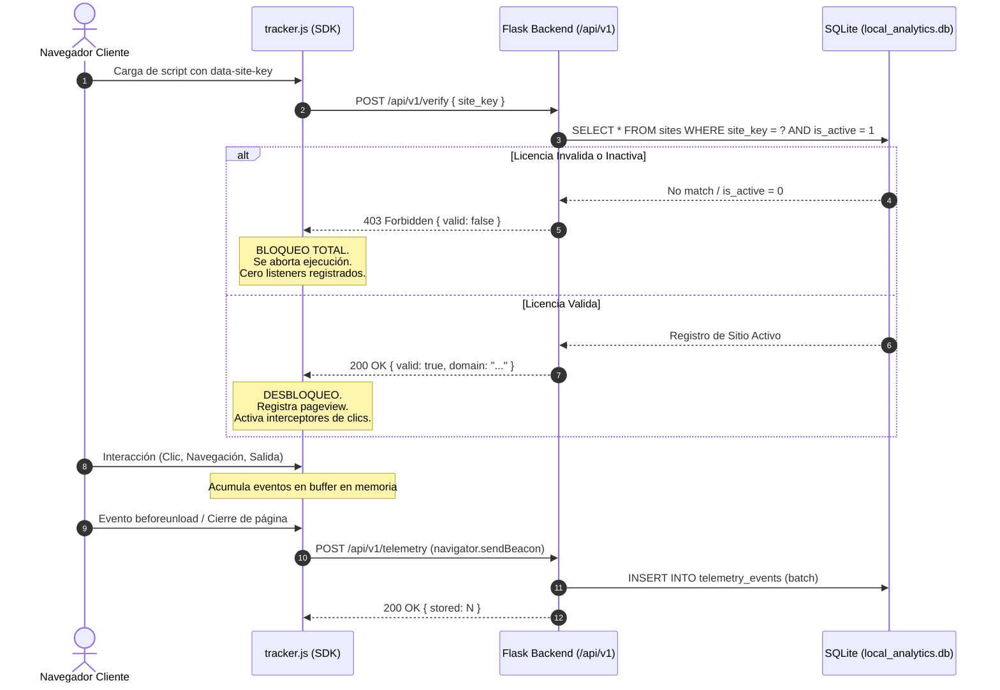
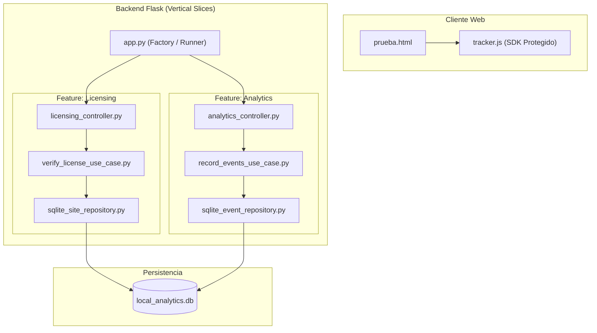

# ADR-001: Arquitectura de Analítica Local y Validación de Llaves

- **Estado:** PROPUESTO
- **Fecha:** 2026-10-22
- **Decisores:** Staff Software Architect & VP of Engineering

## 1. Decisión de Diseño

Se adopta una arquitectura basada en **Vertical Slicing** y **Clean Architecture / Hexagonal** con separación estricta en tres capas por módulo:
- `domain`: Reglas de negocio e interfaces sin dependencias de librerías externas.
- `application`: Casos de uso específicos orquestando las transacciones.
- `infrastructure`: Controladores Flask, adaptadores SQLite y assets del cliente.

## 2. Diagrama de Flujo del Handshake y Telemetría

## 3. Diagrama de Componentes

## 4. Consecuencias
- **Límite de líneas:** Cada clase de repositorio, caso de uso y controlador no supera las 70-110 líneas.
- **Independencia de pruebas:** Los casos de uso pueden probarse unitariamente sustituyendo los repositorios mediante contratos (interfaces).
