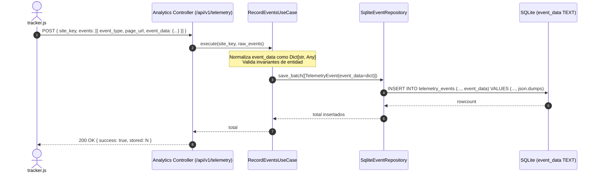

# ADR-002: Esquema Híbrido Relacional con Payload JSON Flexible

- **Estado:** PROPUESTO
- **Fecha:** 2026-10-22
- **Decisores:** Staff Software Architect & Principal DBA

## 1. Decisión de Diseño

Se adopta un patrón **Hybrid Document-Relational Schema** para la tabla `telemetry_events`. Las columnas de indexación y partición crítica (`site_key`, `event_type`, `page_url`, `created_at`) permanecen relacionales indexadas, mientras que el contenido variable del evento del navegador se delega a una columna flexible `event_data` (`TEXT` en SQLite con validación JSON / `JSONB` en PostgreSQL).

## 2. Diagrama de Flujo del Payload Flexible

## 3. Consecuencias
- Desacoplamiento total entre las futuras versiones del SDK frontend y las migraciones de base de datos.
- Capacidad de consultar campos JSON nativamente en SQLite mediante funciones `json_extract(event_data, '$.element')`.
