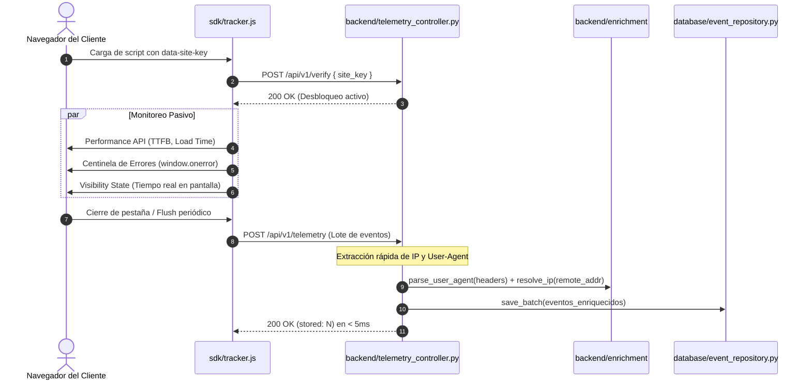

# ADR-003: Arquitectura Tripartita Desacoplada y SDK Empresarial

- **Estado:** PROPUESTO
- **Fecha:** 2026-10-22
- **Decisores:** Staff Software Architect & VP of Engineering

## 1. Decisión de Diseño

Se reestructura el proyecto en tres componentes con responsabilidades estrictamente separadas:
1. `sdk/`: Entorno independiente para el cliente de telemetría.
2. `backend/`: Capa de servicios REST, enriquecimiento (User-Agent, IP) y procesamiento en memoria.
3. `database/`: Capa de persistencia, DDL y adaptadores de repositorios.

Toda la comunicación fluye a través de una API REST unificada con endpoints desacoplados:
- `POST /api/v1/verify` (Handshake)
- `POST /api/v1/telemetry` (Ingesta unificada de clics, rendimiento, visibilidad y errores)
- `GET /sdk/tracker.js` (Distribución del bundle del cliente)

## 2. Diagrama de Flujo del SDK Empresarial y Enriquecimiento

## 3. Consecuencias
- Desacoplamiento total: el cliente puede actualizar su SDK sin tocar código del backend.
- La base de datos es intercambiable (SQLite a PostgreSQL) modificando únicamente el paquete `database/`.
- Todos los archivos se mantienen estrictamente bajo el límite de 150 líneas.
