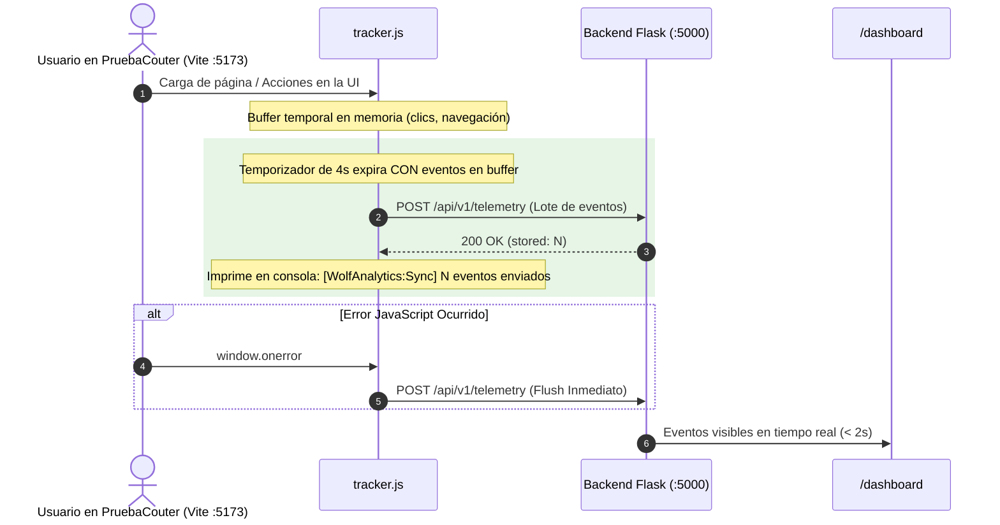

# ADR-004: Estrategia de Flush Oportuno y Dashboard de Inspección

- **Estado:** PROPUESTO
- **Fecha:** 2026-10-22
- **Decisores:** Staff Software Architect & VP of Engineering

## 1. Decisión de Diseño

Se adopta una estrategia de despacho híbrida en el SDK:
- **Interval Flush (4 segundos):** Un temporizador recurrente vacía el buffer si contiene elementos.
- **Immediate Flush:** Para eventos críticos de alta prioridad (errores JS y excepciones no capturadas).
- **Page Unload Flush:** `visibilitychange` (a `hidden`), `pagehide` y `beforeunload` como respaldo final.
- **Feedback Visual (Console + Dashboard):** El SDK emite logs legibles en modo depuración y el backend expone `/dashboard` para ver las métricas sin necesidad de hacer queries manuales SQL.

## 2. Diagrama de Flujo

