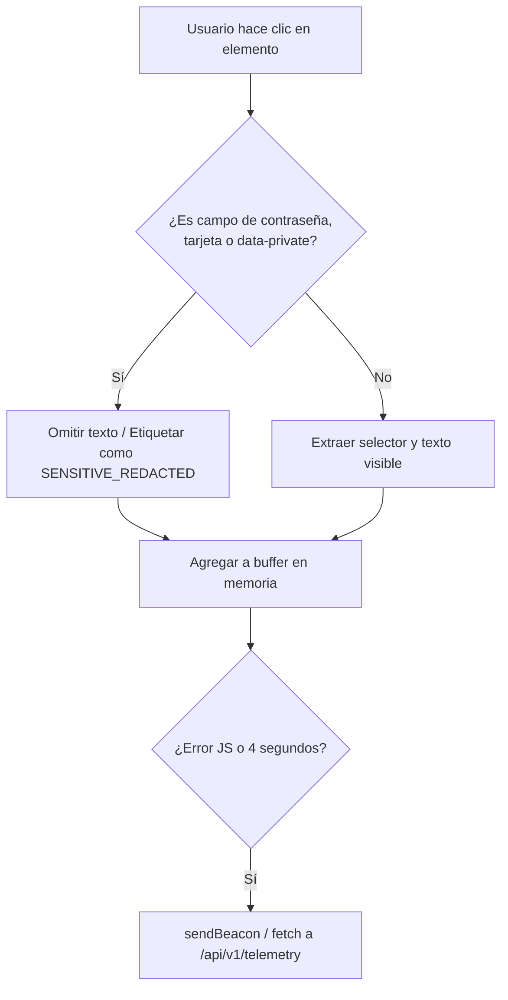

# ADR-005: Seguridad, Sanitización de Datos y Resiliencia Failsafe

- **Estado:** PROPUESTO
- **Fecha:** 2026-10-22
- **Decisores:** Staff Software Architect & VP of Engineering

## 1. Decisión de Diseño

Se definen 3 pilares de seguridad y rendimiento para la plataforma **Counter**:

1. **Failsafe Isolation (Aislamiento Total de Fallos):**
   - El código del SDK se envuelve en un entorno `try/catch` estricto en cada manejador de eventos. Jamás puede lanzar una excepción no capturada que afecte el funcionamiento de la aplicación del cliente.
2. **Sanitización de Datos Privados (PII Shield):**
   - El interceptor de clics y texto ignora elementos de formulario sensibles: `input[type="password"]`, `input[type="hidden"]`, campos con nombres sospechosos (`cc`, `cvv`, `card`, `token`, `ssn`) o atributos `data-private="true"`.
3. **Control de Abuso y Protección DoS:**
   - En el backend se implementa una ventana deslizante de limitación de tasa (Rate Limiting) en memoria para limitar peticiones masivas no autorizadas.

## 2. Diagrama de Sanitización de Eventos

