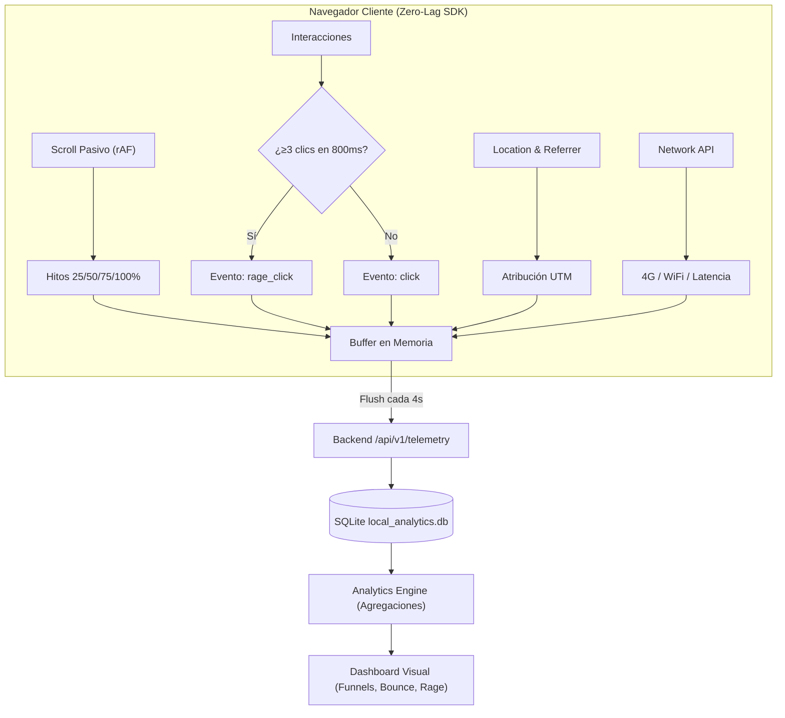

# ADR-006: Telemetría Pasiva de Alta Densidad y Motor de Agregación

- **Estado:** PROPUESTO
- **Fecha:** 2026-10-22
- **Decisores:** Staff Software Architect & VP of Engineering

## 1. Decisión de Diseño

Para recolectar la máxima densidad de información sin degradar la experiencia de usuario (Zero UI Lag), se establecen dos directrices:

1. **Protocolo Pasivo de Renderizado en el SDK:**
   - Todo escuchador de desplazamiento de pantalla (`scroll`) debe registrarse obligatoriamente con `{ passive: true }`. Esto permite que el motor gráfico del navegador ejecute el scroll en el hilo del Compositor sin esperar la ejecución de JavaScript.
   - La comprobación de hitos de scroll (25%, 50%, 75%, 100%) se regula mediante una compuerta booleana de una sola activación (*one-shot milestones*).
2. **Motor de Agregación Desacoplado en Backend:**
   - La base de datos almacena eventos individuales en crudo (`telemetry_events`).
   - Un servicio especializado (`AnalyticsEngine`) ejecuta consultas agregadas utilizando funciones JSON nativas de SQLite (`json_extract`) para calcular tasas de rebote, top de clics y embudos sin alterar la estructura de persistencia.

## 2. Diagrama de Flujo

